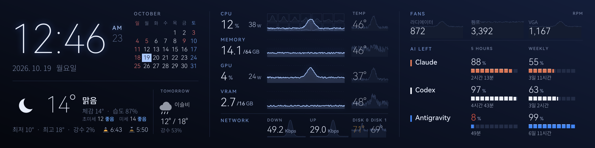

# turzx-ai-monitor

Windows용 **TURZX 8.8" USB 바 LCD**(1920×480) 대시보드로, 제조사 프로그램을 대신합니다.
**Claude, Codex, Antigravity** 요금제 사용량이 얼마나 남았는지와 함께 CPU / GPU / 램 / VRAM
사용률·온도·소비전력, 팬, 네트워크, 시계, 공휴일이 표시되는 달력, 날씨와 미세먼지를 보여줍니다.

[English README](README.md)



Windows가 종료되면 패널에 대기 화면을 띄우고, 다음에 켤 때까지 유지합니다.


## 기능

- **AI 사용량**: 5시간 한도와 주간 한도의 남은 양, 초기화까지 남은 시간, 요금제 이름(Pro, Max 5x 등).
  초기화되면 바로 다시 조회합니다.
- **Gemini API 이번 달 비용**: Antigravity 아래에 표시(선택, Google Cloud 예산 사용.
  [Gemini API 비용](#gemini-api-비용-선택) 참고)
- **하드웨어**: CPU(코어별 그래프 포함), 메모리, GPU, VRAM 사용률과 기록 그래프, 온도, CPU 패키지·GPU
  보드 전력, 메인보드 팬 2개와 GPU 팬, 네트워크 업·다운로드 속도, 디스크 2개 온도
- **시계와 달력**(12/24시간) — 사는 나라의 공휴일 표시
- **날씨**: 지금, 내일, 일출·일몰, 초미세·미세먼지(한국 환경부 등급 또는 미국 AQI)
- **16개 언어**: English, 한국어, 日本語, 简体中文, 繁體中文, Español, Français, Deutsch, Italiano,
  Português, Русский, Polski, Türkçe, Nederlands, Tiếng Việt, Bahasa Indonesia
- **부드럽고 가벼움**: CPU를 꽉 채워 써도 애니메이션 12fps 유지, 메모리 약 70MB, 코어 1개 기준 몇 %
- **튼튼함**: USB 선을 건드려 끊겨도 1초 안팎으로 다시 연결, 드라이버 문제로 죽어도 스스로 재시작
- **화면 끄기**: PC 잠금, 모니터 꺼짐, 화면 보호기 동안 패널을 검게
- **PC가 꺼져 있을 때**: 패널이 TF 카드의 영상을 혼자 재생합니다. 오늘 달력과 개봉 예정·상영 중 영화
  ([TMDB](https://www.themoviedb.org), 무료 API 키) 또는 직접 넣은 영상과 그 정보입니다. 대시보드가 매일
  만들어 백그라운드로 올려 두고, 종료할 때 재생을 시작합니다(패널에 전원이 계속 들어와야 합니다).
- **거꾸로 달았다면** `rotation = 180`으로 화면을 뒤집습니다

## 필요 사항

- Windows 10 / 11 (x64)
- TURZX 8.8" USB LCD (USB `1CBE:0088`, 480×1920). 패널은 한 프로그램만 쓸 수 있으니 제조사 프로그램은 먼저 종료하세요.
- 선택
  - NVIDIA GPU: GPU·VRAM 정보
  - [PawnIO](https://pawnio.eu) (FanControl을 설치하면 함께 설치됨): CPU·램 온도, CPU 전력, 메인보드 팬.
    메인보드 팬 채널은 현재 Nuvoton Super I/O 칩 기준입니다.
  - 이 PC에 로그인된 Claude Code, Codex, Antigravity: AI 사용량

## 설치

1. [Releases](../../releases)에서 `turzx-dashboard.exe`를 받습니다(또는 아래처럼 빌드).
2. 더블클릭하고 **예**를 누르면 설치됩니다. `%LOCALAPPDATA%\Programs\TurzxDashboard`에 복사되고, 시작 메뉴
   바로가기와 *설정 → 앱* 항목이 생기며, Windows와 함께 시작되고 바로 실행됩니다.
   - PawnIO가 있으면 관리자 권한 예약 작업으로 자동 실행합니다(설치할 때 UAC 한 번, 로그인 때는 없음).
   - PawnIO가 없으면 일반 시작 프로그램으로 등록합니다(UAC 없음).

터미널에서:

```
turzx-dashboard install [--no-autostart]
turzx-dashboard uninstall [--purge]     # --purge: 설정·로그·캐시까지 삭제
turzx-dashboard autostart on|off
turzx-dashboard settings                # 설정 창 열기
turzx-dashboard install --quiet         # 메시지 없이 업데이트 (예약 작업이 있으면 UAC 없음)
turzx-dashboard run                     # 설치 없이 실행
```

제거는 *설정 → 앱 → TURZX AI Monitor* 또는 `turzx-dashboard uninstall`로 합니다.

## 설정

시작 메뉴 → *TURZX AI Monitor settings*로 자주 쓰는 설정 창이 열립니다. 나머지는
`%APPDATA%\TurzxDashboard\config.toml`에 있습니다(설정 창의 *파일 편집…*). 어느 쪽이든 저장하면 대시보드가
새 설정으로 다시 시작합니다. 항목은 [영어 README](README.md#settings)와 같습니다: 언어, 12/24시간,
섭씨/화씨, 패널 회전, 도시(또는 위도·경도), 공휴일 나라, 미세먼지 기준, 켤 AI 서비스, 요금제 표시 이름,
팬 이름, 온도를 볼 디스크, PC가 꺼져 있을 때의 영상(TMDB 키, 영상 폴더, 영상 만들기 전 실행할 명령),
Gemini API 비용(`[api_cost]`, 아래 참고).

## AI 사용량을 읽는 방식

각 도구가 이 PC에 저장해 둔 로그인 정보를 읽어, 그 도구들과 [CodexBar](https://github.com/steipete/CodexBar)가
쓰는 사용량 엔드포인트에 묻습니다. 다른 곳으로 보내는 정보는 없고, 로그인 정보는 읽기만 합니다.

- **Claude**: Claude Code의 `/usage` 화면을 5분마다 읽습니다(Claude Code가 직접 보여주는 값. 사용량 API는 몇 시간
  지난 값을 돌려주는 경우가 있었음).
- **Codex**: Codex CLI 로그인으로 ChatGPT 사용량 API를 5분마다
- **Antigravity**: Antigravity 로그인으로 Google Cloud Code 할당량 API를 5분마다

공개 API가 아니라서 바뀌거나 막힐 수 있습니다. 원하지 않는 서비스는 `[ai]`에서 끄세요.

## Gemini API 비용 (선택)

API 키로는 사용 금액을 조회할 수 없어서, Google Cloud **예산(Budget)** 을 씁니다. 예산은 이번 달 누적
비용을 하루에 여러 번(쓴 돈이 없어도) Pub/Sub 토픽으로 보내고, 대시보드는 그 메시지를 30분마다 읽어
Antigravity 아래에 "Gemini API ₩1,234"로 표시합니다. 금액은 결제 계정 통화로 된 Google의 추정치이고 몇
시간 늦을 수 있으며, 첫 메시지는 몇 시간 걸릴 수 있습니다.

[Google Cloud 콘솔](https://console.cloud.google.com)에서 Gemini API 키가 속한 프로젝트(AI Studio 키는
`gen-lang-client-…` 프로젝트)로:

1. **결제 → 예산 및 알림 → 예산 만들기**: *알림 전용*(지출 상한은 API를 멈추게 함), 범위는 그 프로젝트,
   금액은 아무 값(이메일 알림 기준일 뿐). *작업*에서 **이 예산에 Pub/Sub 토픽 연결**을 켜고 그
   프로젝트에 토픽을 만듭니다.
2. **Pub/Sub → 구독 → 구독 만들기**: 그 토픽, 전송 유형 *Pull*, 만료 *만료 없음*(PC를 한 달 꺼 둬도
   지워지지 않게).
3. **IAM 및 관리자 → 서비스 계정 → 서비스 계정 만들기**: 프로젝트 역할은 주지 않습니다. 그다음 구독의
   *권한 → 주 구성원 추가* → 서비스 계정 이메일, 역할 **Pub/Sub 구독자**. 이 키로는 그 구독을 읽는 것
   말고는 아무것도 할 수 없습니다.
4. 서비스 계정의 **키 → 키 추가 → 새 키 만들기 → JSON**. 파일을
   `%APPDATA%\TurzxDashboard\gcp-key.json`으로 저장하고 남과 공유하지 마세요.
5. `config.toml`에:

   ```toml
   [api_cost]
   subscription = "projects/<프로젝트 ID>/subscriptions/<구독 이름>"
   ```

`turzx-dashboard diag api-cost`로 설정을 확인할 수 있습니다(대시보드처럼 쌓인 메시지를 가져갑니다).
`[ai]`에서 Antigravity를 끄면 이 줄도 나오지 않습니다. 새 달이 시작되면 그 달 첫 보고가 올 때까지 0으로
표시합니다.

## 데이터 출처

- 날씨·미세먼지: [Open-Meteo](https://open-meteo.com) (키 불필요). 미세먼지는 측정소 값이 아니라 CAMS 모델 값입니다.
- 공휴일: 한국은 내장 표, 다른 나라는 [Nager.Date](https://date.nager.at)
- 영화: [TMDB](https://www.themoviedb.org) (비상업 무료 API 키, 1주일 캐시). This product uses the TMDB API but is
  not endorsed or certified by TMDB.
- Gemini API 비용(선택): 직접 만든 서비스 계정으로 받는 Google Cloud 결제 예산 알림
  ([Pub/Sub](https://cloud.google.com/pubsub))
- 로그: `%LOCALAPPDATA%\TurzxDashboard\dashboard.log`

## 빌드

Windows에서 Rust(stable)가 필요합니다.

```
cd rust
cargo build --release
```

`turzx-dashboard diag <명령>`으로 패널 없이 미리보기와 점검을 할 수 있습니다:
`layout`, `standby`, `sensors`, `weather`, `profile`, `jpeg-check`, `fps-test`, `test-pattern`.
패널 구동 방식(USB 프로토콜, JPEG 프레임, 부분 재압축)은 [docs/protocol.md](docs/protocol.md)에 있습니다.

## 라이선스

MIT ([LICENSE](LICENSE)). 함께 들어 있는 폰트와 PawnIO 모듈은 각자의 라이선스를 따릅니다:
[THIRD_PARTY_NOTICES.md](THIRD_PARTY_NOTICES.md). TURZX, Anthropic, OpenAI, Google과 관계없는 개인 프로젝트입니다.
